<div align="center">


<h3>
  <a href="https://python-project-ten-roan.vercel.app">▶ Try it live</a>
  &nbsp;·&nbsp;
  <a href="#-how-it-works">How it works</a>
  &nbsp;·&nbsp;
  <a href="#-architecture">Architecture</a>
  &nbsp;·&nbsp;
  <a href="#-team">Team</a>
</h3>

<p>
  <a href="https://python-project-ten-roan.vercel.app"></a>
  
  
  
  
</p>

**Ask a Python question in plain English. Get a clear answer and code you can copy, instantly.**<br/>
No sign-up · no paid AI service · works on any phone, tablet or laptop · light and dark mode.

</div>

---

## ✨ See it in action

<p align="center">
  
</p>

<table>
  <tr>
    <td width="50%">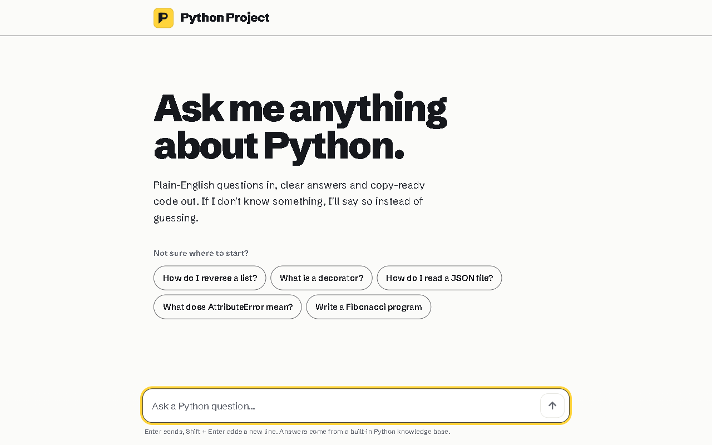</td>
    <td width="50%">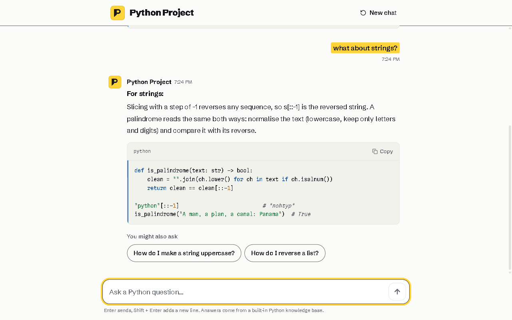</td>
  </tr>
  <tr>
    <td align="center"><b>Start screen</b> — one question box, a few starters</td>
    <td align="center"><b>Follow-ups</b> — "what about strings?" understands the last question</td>
  </tr>
  <tr>
    <td width="50%">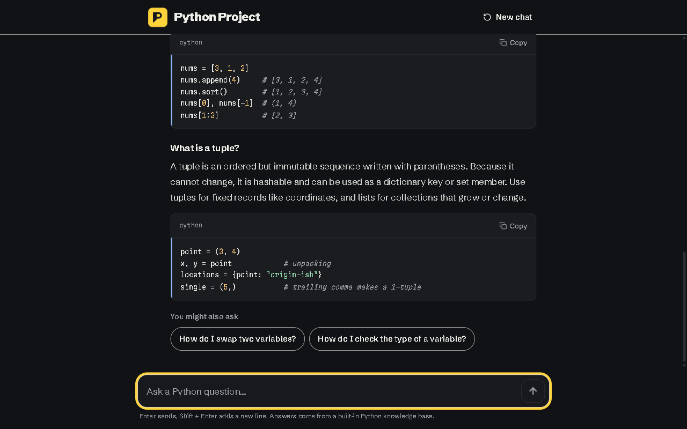</td>
    <td width="50%" align="center">
      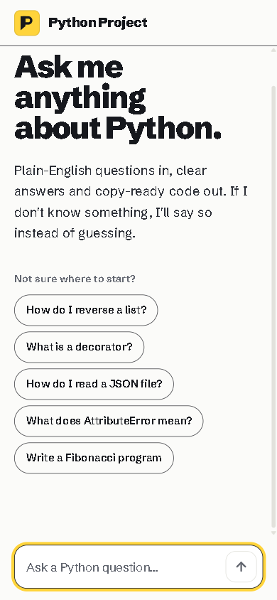
      &nbsp;
      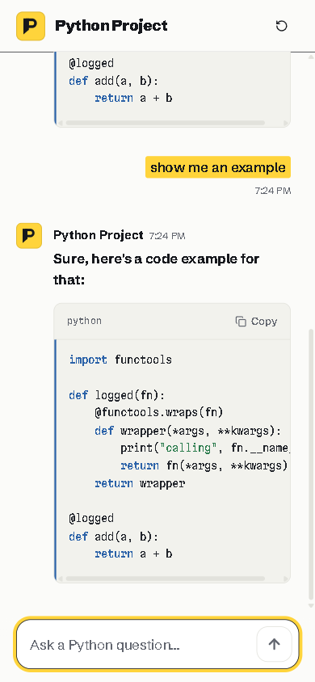
    </td>
  </tr>
  <tr>
    <td align="center"><b>Dark mode</b> — follows your device, two questions in one message</td>
    <td align="center"><b>Phones</b> — same chat, built mobile-first</td>
  </tr>
</table>

---

## 🧠 What makes it smart

Python Project isn't a keyword lookup. It has a small conversation engine on top of a retrieval model:

| It can… | Example | What happens |
| --- | --- | --- |
| Understand messy wording | `how do i revrse a lst` | Typos are corrected against the knowledge base vocabulary |
| Follow up on the last answer | *"How do I reverse a list?"* → `what about strings?` | Swaps the subject and answers *how to reverse a string* |
| Show code on request | `show me an example` | Re-shows the code for the previous topic |
| Go deeper | `tell me more` | Moves to the most closely related entry |
| Answer two things at once | `what is a list and what is a tuple?` | Splits the message and answers both, each with its own heading |
| Chat like a person | `hi`, `thanks!`, `bye` | Replies naturally instead of searching |
| Say "I don't know" | `weather in paris` | Refuses off-topic questions instead of inventing an answer |

**Honest by design:** every answer comes from a curated, hand-checked knowledge base. If the match isn't confident, it says so and suggests questions it *can* answer.

---

## 📚 What it knows

<table>
<tr>
<td>

**170** answers<br/>
**560+** ways of asking<br/>
**160** with runnable code<br/>
**48** topics

</td>
<td>

| Area | Covers |
| --- | --- |
| 🧱 Basics | variables, data types, strings, f-strings, operators, input/output, numbers & bases |
| 📦 Collections | lists, tuples, dicts, sets, slicing, comprehensions, 2D lists, sorting |
| 🔁 Control flow | if/elif, `match`, loops, `break`/`continue`, walrus operator |
| 🧩 Functions | args/kwargs, lambdas, closures, decorators, generators, recursion |
| 🏛️ OOP | classes, `self`, inheritance, `@property`, dataclasses, dunder methods, `__slots__` |
| 🐞 Errors | reading tracebacks + 16 specific errors (`AttributeError`, `NoneType…`, `FileNotFoundError`…) |
| 🗂️ Files & OS | reading/writing, JSON, CSV, Excel, paths, finding/copying files, subprocess |
| 🧰 Standard library | `collections`, `itertools`, `datetime`, `re`, `random`, `heapq`, `hashlib`, logging |
| 📊 Data & ML | pandas, NumPy, matplotlib, scikit-learn, Jupyter |
| 🌐 Web, GUI & games | requests, FastAPI/Flask, scraping, tkinter, pygame |
| 🧮 Classic programs | Fibonacci, primes, palindromes, factorial, binary search, bubble sort, Big O |

</td>
</tr>
</table>

---

## ⚙️ How it works

Everything runs **inside the browser**. There is no backend call per question, so answers appear in a couple of milliseconds and nothing you type leaves your device.

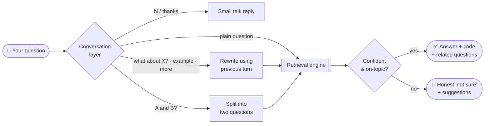

### Inside the retrieval engine

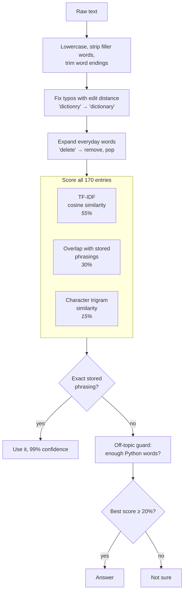

### One message, end to end

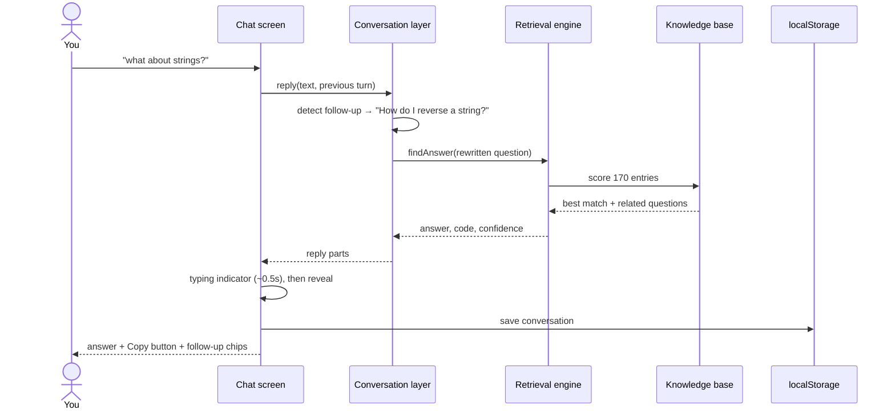

---

## 🏗️ Architecture

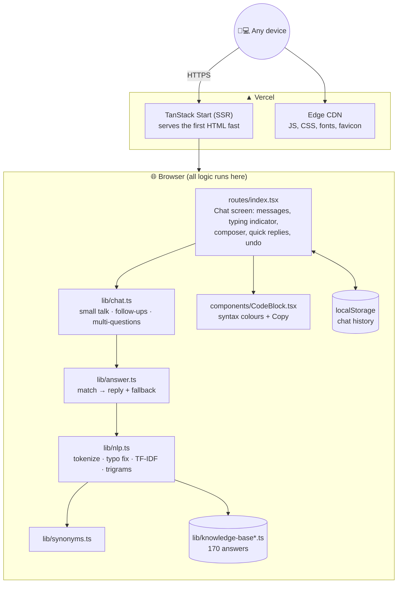

| Layer | Choice | Why |
| --- | --- | --- |
| UI | React 19 + TanStack Start | Server-rendered first paint, then a fast single-page chat |
| Styling | Tailwind CSS 4 with design tokens | One palette that switches cleanly between light and dark |
| Language | TypeScript (strict) | Catches mistakes before they ship |
| NLP | Custom TF-IDF + trigram retrieval | No paid API, works offline, answers in ~2 ms, never invents facts |
| Hosting | Vercel | Global CDN, HTTPS, works on every device |

---

## 🎨 Design

The interface is built around one idea: **a highlighter**. Your questions are marked in Python yellow, like notes in a textbook, and answers are clean, readable text with light code panels. One loud colour, ink-black type, nothing else competing for attention.

- **Type:** Schibsted Grotesk for text, Martian Mono for code
- **Colour:** ink `#16181D`, paper `#FBFBF9`, highlighter `#FFD43B`, code blue `#2B62A8`
- **Motion:** messages rise in, a three-dot typing indicator, nothing that loops for no reason, and all of it switches off when your device asks for reduced motion
- **Accessible:** 4.5:1+ text contrast, visible keyboard focus, labelled buttons, 44px touch targets, screen-reader announcements for new messages

---

## 🚀 Run it yourself

Requires **Node.js 20+**.

```bash
git clone https://github.com/lekhana1907/Python-project.git
cd Python-project
npm install
npm run dev            # open the URL it prints
```

| Command | What it does |
| --- | --- |
| `npm run dev` | Start the app locally with hot reload |
| `npm run check:answers` | Self-test: every stored question, 150+ casual questions, off-topic refusals and conversation features |
| `npm run build` | Production build |

### Deploy your own copy

```bash
npx vercel --prod      # vercel.json already sets the right build
```

---

## 🧩 Add an answer

Add an entry to any `src/lib/knowledge-base*.ts` file:

```ts
{
  id: "fibonacci",                         // unique name
  topic: "Classic programs",               // shown as the answer's topic
  questions: [                             // different ways people ask it
    "How do I print the Fibonacci sequence?",
    "Write a Fibonacci program in Python",
  ],
  keywords: ["fibonacci", "sequence"],     // extra words that should match
  answer: "Each Fibonacci number is…",     // the explanation
  code: "def fibonacci(n): ...",           // optional example
}
```

Then run `npm run check:answers` to make sure every question still reaches the right answer.

---

## 📁 Project structure

```text
src/
├── routes/
│   ├── __root.tsx            page shell, fonts, meta tags
│   └── index.tsx             the chat screen
├── components/
│   ├── CodeBlock.tsx         code panel with Copy
│   └── Logo.tsx              the Python Project mark
├── lib/
│   ├── chat.ts               conversation layer (follow-ups, small talk, multi-questions)
│   ├── answer.ts             match → reply
│   ├── nlp.ts                retrieval engine
│   ├── synonyms.ts           everyday-word expansions
│   └── knowledge-base*.ts    170 curated answers
└── styles.css                colours, fonts, motion
scripts/check-answers.ts      automated self-test
docs/                         banner, demo animation, screenshots
```

---

## 👥 Team

<table>
  <tr>
    <td align="center" width="200">
      <br/>
      <b>Lekhana H</b>
    </td>
    <td align="center" width="200">
      <br/>
      <b>Jamuna B</b>
    </td>
  </tr>
</table>

---

<div align="center">
  <sub>Made with 🐍 and a yellow highlighter · <a href="https://python-project-ten-roan.vercel.app">python-project-ten-roan.vercel.app</a></sub>
</div>
